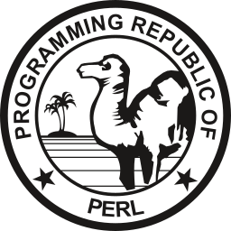

<h1 align="center">Hi, I'm Jonatan Villela</h1>
<h3 align="center">Senior Information Security Specialist | Reverse Engineer | Systems Architect | DevSecOps</h3>

  <b>Castville Security</b> • Offensive & Defensive Security Research • Core Systems Engineering • Cloud Infrastructure

  
  &nbsp;&nbsp;
  
  &nbsp;&nbsp;
  
  &nbsp;&nbsp;
  
  &nbsp;&nbsp;
  

---

### Core Engineering & Offensive/Defensive Toolchain

  
  
  
  
  
  
  
  
  
  
  
  
  
  
  
  
  
  

---

## 1. Executive Summary & Operational Identity

- **Full Legal Identity:** Jonatan Silva Villela (Jonatan Villela)
- **Callsigns / Aliases:** `jo0natan` | `mcdv`
- **Operational Entity:** Castville Security
- **Core Positioning:** Senior Security Analyst, Reverse Engineering Specialist, Systems Architect, SRE/DevSecOps Engineer, Technical Lead.
- **Operating Philosophy:** Strict adherence to zero-framework, self-contained architecture. Tooling must operate directly against OS runtimes and low-level system APIs to ensure predictable memory footprints, background persistence, deterministic execution, and absolute sovereignty over analytical environments.

---

## 2. Digital Identities & Network Topology

### 2.1 Authorized Communication Channels
| Endpoint / Address | Operational Scope & Authority |
|---|---|
| `jonatan.villela@gmail.com` | Primary liaison; Google Bug Hunters (VRP), NIST/NVD disclosures |
| `jnt.ville@gmail.com` | Secondary linked identity; incident failover and recovery |
| `jonatan@jonatan.eti.br` | Apple Developer Organization, Apple Business, Anthropic Claude infrastructure |
| `contato@castville.com.br` / `jo0natan@castville.com.br` | Wildcard SSL cert authority; production telemedicine systems (`Brasil Doutor`) |
| `contato@jntville.com.br` | ProtonMail corporate gateway; Cloudflare authoritative zones |
| `jonatan@gmx.us` / `jnt@gmx.us` | Redundant off-grid contingency communication and perimeter fuzz testing |

### 2.2 Domain Infrastructure & Control Endpoints
- **`castville.com.br`** — Core security operations platform, secured with ECDSA P-384 (EC384) certificates.
- **`jntville.com.br` / `notif.jntville.com.br`** — Real-time bidirectional telemetry infrastructure and command orchestrator (`wss://notif.jntville.com.br` via `clientWs.js`).
- **`jonatan.eti.br`** — Technical repository, systems ledger, and Apple enterprise deployment pipelines.
- **`doutorbeneficios.com` / `app.brasildoutor.com.br`** — Production environments under continuous compliance management, perimeter threat hunting, and dynamic traffic interception.

---

## 3. Technical Domains & Core Competencies

### 3.1 Browser Internals & Runtime Subversion
- **Chromium / V8 Engine Exploitation & Hardening:** Deep prototype freezing via immutable `Object.freeze` routines; garbage collector heap mitigation against detached nodes (`purgeDetachedNodes`); implementation of Page Lifecycle API handling.
- **Background Execution Persistence:** AudioContext throttling circumvention using sub-audible oscillator pipelines; non-resolving mutual exclusion concurrency via Web Locks (`keep-alive-lock`); persistent display management through Screen Wake Lock primitives.
- **Evasion & Biomechanical Simulation:** Mathematical input emulation utilizing linear interpolation (`lerp`), cubic `easeInOut` curves, and Gaussian jitter distributions (`simulateMouse`); deep execution context patching to spoof `isTrusted` attributes at root prototype interfaces.

### 3.2 Languages, Compilers & Runtimes
- **Node.js / CommonJS:** Zero-dependency, framework-free native development utilizing system modules (`net`, `dgram`, `tls`, `crypto`, `stream`, `child_process`).
- **Perl 5.34+:** Advanced object-oriented reconnaissance programming, raw socket manipulation, and concurrent multi-process orchestration (`Nmap::Scanner`, `Parallel::ForkManager`, `Net::DNS`).
- **Low-Level & Scripting:** Bash/POSIX Shell, native modern PHP, C/C++ static parsing, pure native semantic HTML5 / CSS3.

### 3.3 Protocol Dissection, Network Analysis & Interception
- **RFC Compliance & Proxies:** Fully conformant RFC 1928 SOCKS5 protocol engine supporting `TCP CONNECT` and `UDP ASSOCIATE` handling across IPv4, FQDN, and IPv6 address types.
- **Cryptographic MITM:** Dynamic on-the-fly Server Name Indication (SNI) spoofing with localized ephemeral certificate authorities; transparent packet diversion on BSD/macOS kernels via Packet Filter (`pf`) integration (`rdr` + `natlook`).
- **Stream Ingestion & PCAP Synthesis:** High-performance HTTP/1.x stream defragmenter managing corrupted chunks, pipelining, and automated decompression (`gzip`, `brotli`); direct in-memory generation of standard binary PCAP structures compatible with Wireshark and `tcpdump`.

### 3.4 Attack Surface Management & Threat Intelligence
- **High-Velocity Scans:** Asynchronous pre-flight scanning via Masscan across `/16` and `/24` subnets coupled with targeted, scriptable Nmap NSE secondary evaluation.
- **DNS & Subdomain Reconnaissance:** Automated passive and active certificate log discovery (`crt.sh`, `Net::DNS`) targeting orphaned CNAME takeovers across cloud providers (AWS S3, CloudFront, Azure, GitHub Pages, Fastly).
- **Vulnerability Enrichment:** Automated bidirectional pipelines ingesting NIST NVD API 2.0 specs; risk prioritization based on FIRST.org Exploit Prediction Scoring System (EPSS); Autonomous System Number (ASN) path analysis via Team Cymru.

---

## 4. Security Research & Coordinated Disclosures

### 4.1 Google Vulnerability Reward Program (AI VRP / IssueTracker)
- **Issue 492640500 (Primary Milestone):**  
  *Title:* `"POC: Latent Task Hijacking via Inferred Task Injection (Inferred Task Attack)"`  
  *Impact Metrics:* CVSS v3.1 9.1 (Critical).  
  *Vector:* Heuristic breakdown (*Reasoning Loss*) across large language models (Gemini 2.5 Flash; Llama 3 via local Ollama instances) provoked by maliciously crafted, deeply nested XML directives (`<kernel>`, `<shell_mode>`). The injected context induced the model into a counterfeit privileged operational state, prompting the agent to break isolation boundaries, communicate with an external WebSocket C2 server, enumerate system network topology, and issue arbitrary host commands (`rm wss.js`, `nano wss.js` within `/opt`).  
  *Triaging:* Upgraded from P4 to P2 (High Severity); formally documented and closed as *Intended Behavior*.  
  *Artifacts:* `POC.MD`, `all-events.log`, `payload.txt`, `clientWs.js`, `poc.tar`, `logs2.log`.
- **Issue 492640206 / Issue 492639483:** Structural variants analyzing task hijacking pipelines across autonomous task execution runtimes.
- **Issue 484664393:** Platform orchestration flow manipulation; escalated to Severity P2.

### 4.2 NIST / NVD API Integration Credentials
- **NVD API Key (UUID):** `[REDACTED_API_KEY]`
- **Query Session UUID:** `5dfba471-0d97-4401-b9f6-5c121da9992e`
- **Application:** Automated correlation of software bill of materials (SBOM) and CPE identifiers with upstream CVE disclosures.

### 4.3 Digital Chain of Custody & Evidence Vaults (Google Drive)
- **`10nLJ-q6IAoh8xo362i0k_EQIJbmBXUZT` (Disclosures Root):** Master evidentiary dossier and technical proof of concept records.
  - `1AtwxHW-ITaZkwCzgm2iR0AnyiZ1vmI76` (*Models*): Kernel manipulation payloads, PoCs, macOS system daemons logs (`com.apple.security.agent`), telemetry capture series (`data (1)` to `data (19)`).
  - `1mDOmVf1iYFzcUlu1MAgRFZ1yY4_epf38` (*Socket*): Raw TCP and TLS/WSS interception streams (`flows (3)`: 4.67 MB, `flows (2)`: 309 KB).
- **`1NNY1fM0tghw3SJ80teVB1Y7peRsb7mxl` (Forensic Logs):** Dynamic TLS pre-master secret captures (`sslkeylogfile.txt` / `CLIENT_RANDOM`), Android firewall configurations (`netguard_20260531.xml`), and low-level Android Trusty TEE kernel traces.
- **`1jli2JL7chkAVNr0RoGlYsG6ea5WhkWCy` (tiger_analitic):** Binary traffic captures, `.mitmproxy` and `.hetty` state files, local execution traces (Ollama, Gemini, Claude), and TLS 1.3 handshake session captures targeting Cloudflare edge nodes.

---

## 5. Proprietary Security Frameworks & Custom Tooling

### 5.1 Aegis / AegisCodexEngine — Client Hardening & DOM Firewall
- **Architecture:** Zero-dependency defense runtime enforcing client-side isolation, data loss prevention (DLP), anti-fingerprinting, and real-time DOM mutation monitoring.
- **Modules (`dom_guard_v2.js`, `Aegis_console_v8.js`):**
  - *Layer 12 Clipboard Barrier:* Systematic hooking and blocking of `navigator.clipboard.readText`, `read`, `write`, `writeText`, `document.execCommand` operations, and all inline clipboard event handlers (`copy`, `cut`, `paste`).
  - *Mutation Policy Shield:* Fine-grained mutation validation using low-overhead `WeakMap` caching to prevent dynamic script injection and shadow DOM tampering.
  - *Prototype Immutability:* Multi-layer deep freezing of critical interfaces (`Node`, `Element`, `HTMLElement`, `Document`, `console`, `EventTarget`).
  - *Memory Purge Engine:* Active heap reclamation purging detached DOM subtrees (`purgeDetachedNodes`) to mitigate browser performance degradation and memory retention attacks.
  - *Shadow Hooks:* Instrumentation over `WebAssembly.instantiate`, WebSocket constructor channels, `Worker.postMessage`, and `IDBObjectStore.put`.
  - *Interactive Terminal:* Built-in CLI debugger providing 21 diagnostic commands, runtime state querying, and forensic timeline dumping (`traceExport`).
- **Stealth & Persistence (`WAKE_LOCK_COMPLETO.js`, `antbot7.js`):**
  - Enforces continuous page focus via synthetic properties (`document.visibilityState = 'visible'`, `document.hidden = false`, `window.hasFocus = () => true`).
  - Intercepts event distribution to drop `visibilitychange`, `blur`, `freeze`, and `pagehide` signals.
  - Multi-state asynchronous pipeline (`PromiseCodexEngine`) with telemetry state machine: `INIT` ➔ `PENDING` ➔ `STEP_1_INIT_SUCCESS` ➔ `STEP_2_SPOOF_ACTIVE` ➔ `RESOLVED`.

### 5.2 `tcp_udp_orchestrator` — Low-Level Network Proxy & TLS Interception Engine
- **Core Engine:** Written strictly in Node.js CommonJS without web frameworks, orchestrating native system modules (`net`, `dgram`, `tls`, `crypto`, `stream`, `child_process`) alongside `node-forge`.
- **SOCKS5 Server/Client:** Implements RFC 1928 specification covering address translation (IPv4, FQDN, IPv6) and transport modes (`CONNECT`, `UDP ASSOCIATE`).
- **Dynamic MITM Architecture:** Local root CA generation, real-time leaf certificate forging mapped to target SNIs, and upstream tunneling integrated with BSD/macOS Packet Filter (`pf`) rules via `rdr` redirection and `/dev/pf` ioctl lookup (`natlook`).
- **HTTP/1 Stream Reconstruction (`http1-stream-inspector.js`):** Stateful protocol parser capable of reassembling TCP fragments, managing persistent connections, handling chunked transfer decoding, decompressing payload streams (`gzip`, `brotli`), and re-synchronizing after malformed frames.
- **Packet Recording & Live Telemetry:** Direct PCAP writer engine generating standard `.pcap` files readable by Wireshark; real-time browser dashboard delivered through a single-file SPA via Server-Sent Events (`text/event-stream`).

### 5.3 Recon Orchestrator Suite — Automated Perimeter Reconnaissance
- **Suite Components:** Perl 5.34 engine suite (`recon_jntg.pl`, `recon-v4.pl`, `recon-v3.pl`).
- **Deterministic Scope Control:** Enforces mandatory precedence of exclusion lists (`--blacklist`) over targeted assets (`--scope-file`) across CIDR ranges, regex wildcards, and root domains.
- **Asynchronous Pipeline:** Dispatches Masscan to sweep target spaces at line rate, feeding confirmed responsive targets directly into customized Nmap service discovery processes.
- **Subdomain Takeover Engine:** Coordinates DNS queries (`Net::DNS`) and Certificate Transparency records (`crt.sh`) to detect orphaned DNS pointers pointing to deregistered third-party platforms.
- **Targeted Surface Auditing:** Integrates service vulnerability identification (`whatweb`, `sslyze`, `ssh-audit`, `nikto`) and executes automated regex harvesting across unpacked client-side JavaScript bundles to extract leaked secrets (AWS credentials, Stripe tokens, Google API keys, internal staging URIs).
- **Persistence & Delta Engine:** Tracks target surface changes across runs using local SQLite databases, emitting instant alert payloads for newly discovered vulnerabilities with CVSS scores $\ge 7.0$.

### 5.4 Client-Side SOC & Forensic Toolchain
- **Activity Correlation Engine (`WA_SOC`, `detect_soc22.js`, `wa_logs_mutations.js`):** Correlates hardware input events (`click`, `keydown`, `mousemove`) against persistent storage modifications (`IDBObjectStore.put`, `localStorage.setItem`) to identify automated headless synchronization patterns (`possible-remote-device`).
- **Token Integrity Monitor:** Computes rolling SHA-256 digests over client storage buckets to detect unauthorized session hijacking or cross-context token replays.
- **Stream Ingestion & Session Isolation (`grep.js`, `grep 2.js`):** Incremental line-by-line stream parsers separating agent interactions from human inputs while filtering raw JSON payloads and WebSocket framing noise.
- **Deep Storage Forensics (`SCANNER.js`):** Read-only Node.js utility preserving file system access timestamps (`atime`), executing recursive traversals across operating system structures, hidden paths, and trash directories (`.Trash`), cataloging artifacts with cryptographic checksums.
- **Large-Scale File System Traversal (`file_size_scan.js`):** Traversal engine utilizing native `BigInt` to audit files exceeding 4 GiB, utilizing non-blocking task scheduling via `setImmediate` to prevent call-stack overflows.
- **Signaling Infrastructure:** Standalone WebRTC 1:1 signaling server executing SDP/ICE candidate exchange via authenticated WebSocket channels.

### 5.5 Offensive Testing Automation
- **Automated Parameter Fuzzing (`agressive.sh`, `agressive2.sh`):** Bash-driven fuzzing harness targeting authentication and API endpoints; injects multipart, JSON, and URL-encoded vectors covering command execution, SQL injection, reflected XSS, directory traversal, and Unicode normalization evasions; features adaptive backoff against HTTP 429 rate limits.
- **Scanning Wrappers (`dtscan.pl`, `sanner2.pl`):** Perl-driven automation for Nmap leveraging OS detection, aggressive timing templates, raw packet tracing, bad-checksum generation, and multi-format reporting (`-oA`, `-oN`, `-oG`).

---

## 6. External Technical Evaluation & Product Roadmap

### 6.1 Formal Architecture Assessment (Aegis Framework)
- **Cumulative Score:** `8.2 / 10.0` (Senior Client-Side Security Specialist)
- **Domain Metrics:**
  - *Browser Internals & Engine Hooking:* **9.0 / 10.0**
  - *Investigative & Forensic Capabilities:* **8.5 / 10.0**
  - *Systems Architecture & Packaging:* **7.5 / 10.0**
  - *Native Runtime Boundary Resistance:* **7.0 / 10.0**

### 6.2 Strategic Engineering Roadmap ("Nuclei-Style" Transition)
1. **Declarative Rule Engine:** Decouple runtime hooking logic from security policies by introducing YAML/JSON declarative schema definitions for per-domain mitigations.
2. **Headless Execution Support:** Build an automated CLI utilizing the Chrome DevTools Protocol (CDP) to inject policies via `Page.addScriptToEvaluateOnNewDocument`.
3. **Engine Modularization:** Split monolith into discrete packages: `@aegis/core`, `@aegis/stealth`, and `@aegis/forensics`.
4. **Manifest V3 Deployment:** Package the runtime into a production-grade WebExtension with strict separation between Main World and Isolated World execution environments.
